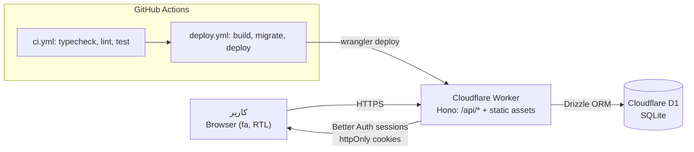
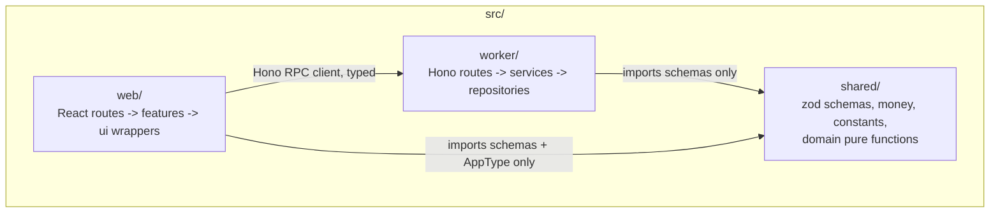

# Architecture

Status: Stage 0. This document is the architecture overview required before app code. It is updated at every stage.

## Overview

«دخل‌وخرج» is a single-repo, single-package Persian personal-finance web app. One Cloudflare Worker serves both the API (`/api/*`) and the built SPA (static assets with SPA fallback). The database is Cloudflare D1 (SQLite) accessed through Drizzle ORM. Authentication is Better Auth with the username plugin (no email). The UI is React 19 + Vite, RTL-first, built on the Kashi design system.

Design goals, in priority order: exact and explainable money math, Persian-first UX, minimal calm interface, low-friction entry (an expense in about three interactions).

## System context



## Runtime topology

- One Worker, one D1 database, no external services at runtime.
- Static assets are served by the Workers Assets layer with `not_found_handling: "single-page-application"`; the Worker runs first only for `/api/*` (`run_worker_first`).
- No CDN fonts, no third-party scripts, no runtime calls to foreign services (unreliable from Iran). Vazirmatn is self-hosted from Stage 1.
- D1 has no interactive transactions. Every multi-row financial write is a single `db.batch()` call (see schema.md and AGENTS.md).

## Module layering



Backend rule: `routes` (HTTP + Zod validation) call `services` (business rules), which call `repositories` (Drizzle). Only repositories touch the database. Every repository function takes `userId` and filters by it.

Frontend rule: `src/web` may import from `src/shared` and the `AppType` type from the worker entry; nothing else crosses the boundary. A feature never imports another feature's internals, only its public `index.ts`.

Backend modules (Phase 1): `auth`, `accounts`, `transactions`, `categories`, `people`, `debts`, `budgets`, `reports`, `settings`. Phase 2 adds: `recurring`, `planned-payments`, `goals`, `assets`, `imports`, `attachments`, `currencies`.

## Financial invariants (enforced in code and tests)

1. Money is an integer in minor units with an explicit currency code. No floating point. Values above `Number.MAX_SAFE_INTEGER` are rejected.
2. IRR is stored in Rial. Display unit is Toman (default) or Rial: UI divides by 10 to display, multiplies by 10 on input. Currencies are never added, compared or converted silently; conversions always show rate, source and date (manual rates in MVP).
3. Transaction types: `INCOME`, `EXPENSE`, `TRANSFER`, `DEBT_BORROWED`, `DEBT_LENT`, `REPAYMENT_PAID`, `REPAYMENT_RECEIVED`. Only `INCOME`/`EXPENSE` count in income, expense, budgets and category reports. Every type affects account balances. Transfers and debt movements never inflate income or expense.
4. A transfer is two legs written in one atomic `db.batch()` with a shared `transfer_id`. Cross-currency transfers require both amounts explicitly.
5. Account balance = opening balance + sum of signed, non-deleted transactions, computed by one shared function in `src/shared/domain`. A cached balance column, if used, is updated in the same batch and tested against the computed value.
6. Soft delete (`deleted_at`) for financial records; `created_at`/`updated_at` kept. Timestamps stored in UTC, displayed as Jalali in Asia/Tehran. Jalali periods; week starts Saturday.
7. User isolation everywhere: user A can never read or change user B's data (proven by tests).

## Key decisions

| Decision | Record |
| --- | --- |
| Public URL on `workers.dev` (custom domain not routable yet) | ADR-0001 |
| Worker name `dakholvakharj`, app title constant «دخل‌وخرج» | ADR-0002 |
| Fixed stack (React 19, Hono, D1, Better Auth, Kashi) | user brief, section 3.1 — not an ADR |

## Folder map

```
AGENTS.md  README.md  wrangler.jsonc
docs/        architecture.md routes.md schema.md component-hierarchy.md
             design-system.md copy-guide.md deploy.md mvp-plan.md stage-reports/ adr/
drizzle/     SQL migrations (Stage 1+)
.github/workflows/  ci.yml deploy.yml
src/shared/  zod schemas, money, constants, domain logic (no DOM, no Workers APIs)
src/worker/  index.ts, env.ts, auth/, db/, middleware/, modules/<domain>/{routes,service,repo,*.test.ts}
src/web/     app/, routes/, features/<domain>/{components,hooks,api,*.test.tsx}, components/ui, lib/, styles/
tests/e2e/   Playwright (Stage 5, if environment allows)
```
