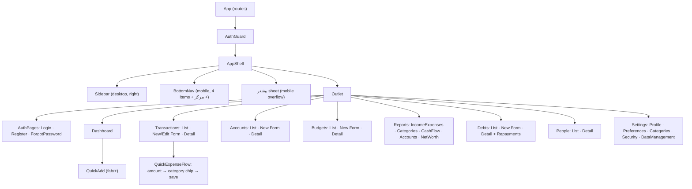

# Component hierarchy

Status: Stage 0 plan, grown stage by stage. App-specific components are thin wrappers over Kashi components/tokens in `src/web/components/ui`; no other UI kit, no second icon or date library.

## AppShell rules (RTL, mirrored F-pattern)

- `html lang="fa" dir="rtl"`; logical CSS properties only (`inline-start`/`inline-end`), never physical left/right.
- Sidebar sits on the **right**; page title top-**right**; the single most important figure (total balance) top-right on the dashboard.
- List rows: title on the right, amount at the left end. Filters and secondary actions toward the left. Primary button first at inline-start (right) of a button group.
- Directional icons (chevrons, arrows, back, progress) are mirrored; logos are not.
- LTR islands inside RTL text (phone numbers, card numbers, IBAN, URLs) use `dir="ltr"` or `<bdi>`.

## Shared UI wrappers (`src/web/components/ui`, grown from Stage 2)

`Page` (title + content max-width ~1100) · `PageHeader` · `AmountText` (sign + Persian digits, tabular) · `JalaliDateText` · `MoneyInput` (Toman/Rial aware, Persian digit normalization, amount in words via Kashi) · `CategoryChip` · `AccountChip` (bank logo) · `EmptyState` (one sentence + one button) · `ConfirmDialog` (destructive actions) · `FilterPopover` · `Skeleton` set · toast helpers.

## Screen states (mandatory per screen)

Every screen ships with designed empty, loading (skeleton), error and confirmation states. Destructive actions ask for confirmation. Success/failure use toasts. At most five information blocks above the fold on the dashboard; advanced fields under «جزئیات بیشتر».
