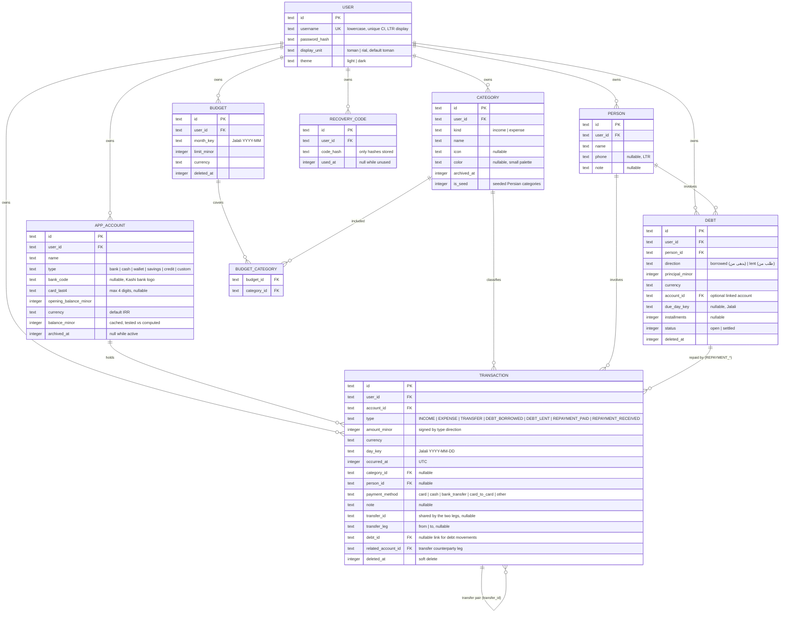

# Database schema

Status: Stage 0 plan. The ERD is finalized at Stage 1 together with the first Drizzle migration; every later change goes through drizzle-kit migrations in `drizzle/`.

## Conventions

- All tables: UUID primary keys (application-generated), `created_at`/`updated_at` UTC timestamps, soft delete via `deleted_at` for financial records.
- User isolation: every table that holds user data carries `user_id` (index) and every repository query filters by it.
- Money: `amount_minor` integer columns with a companion `currency` code column. IRR amounts are stored in Rial. No floats anywhere.
- Timestamps: stored UTC (ISO-8601), displayed Jalali (Asia/Tehran). "Financial day" of a transaction is stored as a Jalali `YYYY-MM-DD` day key alongside the UTC instant.
- Better Auth owns its tables (`user`, `session`, `account`, `verification`) via the Drizzle adapter; the username plugin adds the username field. Emails are never collected; if the schema requires one, a non-routable placeholder `username@users.invalid` is stored and never shown.

## Planned ERD

## Notes on tricky parts

- **Transfers**: stored as two `TRANSACTION` rows sharing `transfer_id` (one `transfer_leg = from`, one `= to`), written in a single `db.batch()`. Neither row is `INCOME`/`EXPENSE`, so income/expense totals stay untouched by construction.
- **Debts**: `DEBT_BORROWED`/`DEBT_LENT` record the principal (optionally moving money through the linked account); repayments are `REPAYMENT_PAID`/`REPAYMENT_RECEIVED` transactions referencing `debt_id`. Remaining balance and overdue state are computed by pure functions in `src/shared/domain` from non-deleted rows.
- **Balances**: computed = opening + signed sum of non-deleted transactions of the account. The cached `balance_minor` is updated in the same batch as any write and tested to equal the computed value.
- **Budget utilization**: sum of `EXPENSE` transactions in the budget's categories for the Jalali month, against `limit_minor`; amber at 80%, red above 100%.
- **Seeds**: Persian income/expense categories are copied to each new user at registration (`is_seed = 1`), then fully editable/archivable per user.
